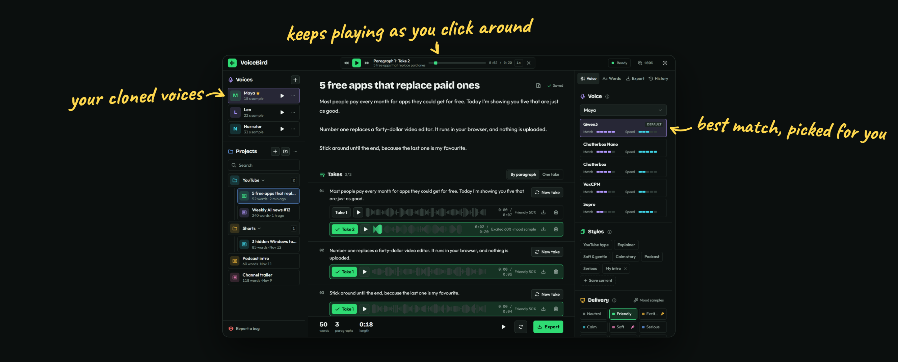
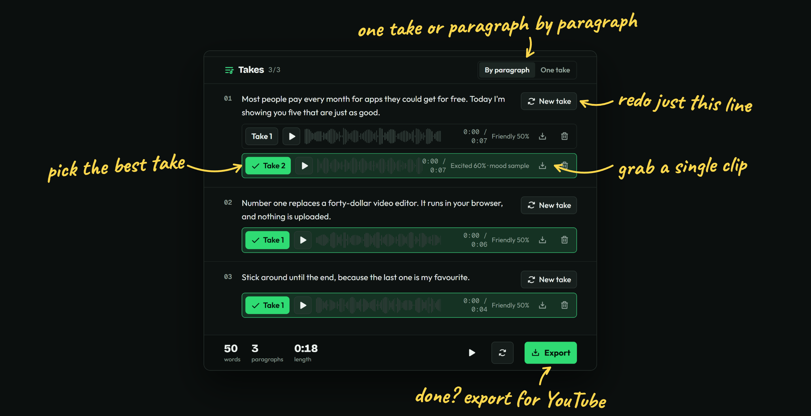
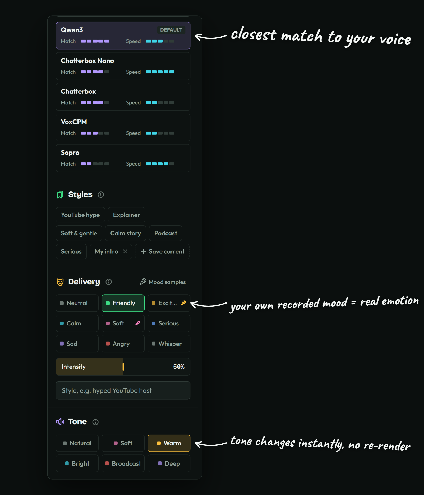
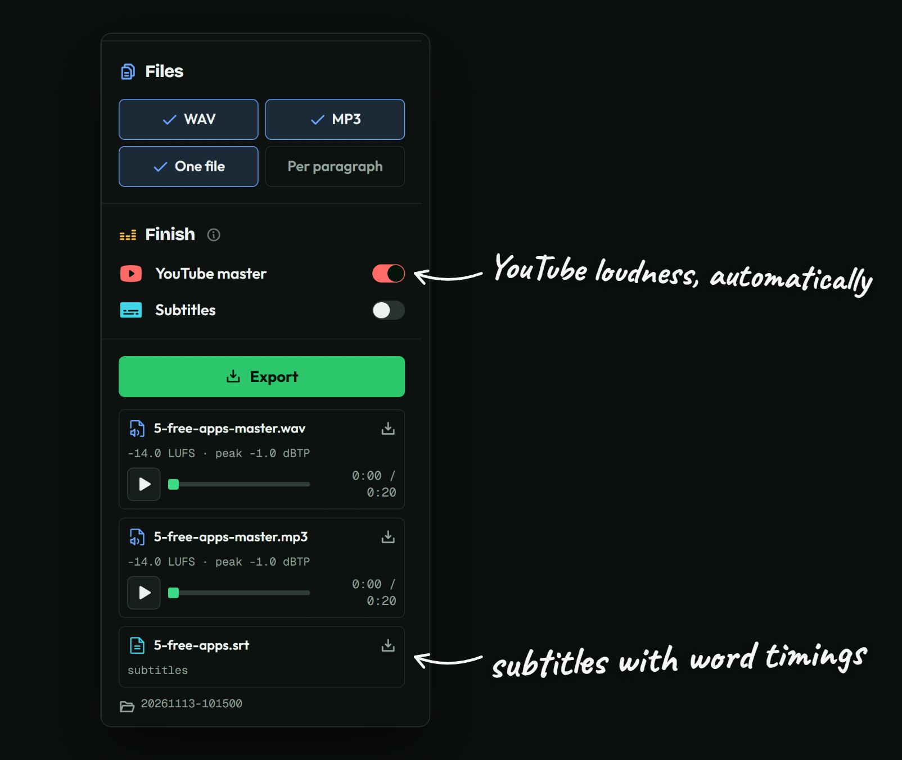

<div align="center">


# VoiceBird

**Your voice. Any script. Studio-ready.**

Clone a voice from a short clip and turn scripts into YouTube-ready voice-overs.<br>
Free, unlimited, and 100% on your own PC.

[How it works](#how-it-works) · [Quick start](#quick-start) · [Engines](#engines) · [Full guide](docs/GUIDE.md)

<br>



</div>

<br>

## Why VoiceBird

|  |  |
|---|---|
| **Private** | Nothing leaves your computer. No account, no cloud, no per-minute fees. |
| **Sounds like you** | Engines that copy the timbre, pace and delivery of your sample. |
| **Built for creators** | Takes to compare, one-click styles, export at YouTube loudness with subtitles. |

## How it works



1. **Add a voice.** Upload or record 10 seconds to 5 minutes of clean speech.
2. **Paste a script.** A blank line becomes a pause.
3. **Generate, pick, export.** Redo any line, keep the rest.

## Make it sound right

<p>


</p>

- **Tone**: Soft, Warm, Bright, Broadcast or Deep. It changes instantly, with no regenerating.
- **Mood samples**: record your voice calm, excited or soft, and that emotion speaks like you.
- **Styles**: one click sets mood, pace, pitch and tone. Save your own.
- **Player**: keeps playing while you switch projects. <kbd>Space</kbd> plays and pauses.
- **Interface size**: 90% to 150%, from the top bar.

## Quick start

**Install.** Run **`VoiceBird-Setup.exe`** from [Releases](https://github.com/Suraj64x/VoiceBird/releases) on Windows 10 or 11. Pick your voice engines, and setup installs everything else: Python, FFmpeg, speech recognition and the voice models. It checks each part as it goes. You don't need admin rights.

**Open** VoiceBird from the desktop or the Start menu. It runs in your browser at **http://localhost:7878**, with no extra window to keep open. **Quit** from the power button in the top bar.

**Fix** anything that breaks with **Repair VoiceBird** in the Start menu, or by running the installer again. It reinstalls only what is missing or broken, and moves an unreadable settings file aside instead of deleting it. Your voices and projects are always kept.

An NVIDIA graphics card with 4 GB is recommended, and setup finds it on its own. The processor works too, just slower.

<details>
<summary>Build from source</summary>

```bash
git clone https://github.com/Suraj64x/VoiceBird
cd VoiceBird/ui && npm install && npm run build && node ../installer/art.mjs
powershell -ExecutionPolicy Bypass -File ../installer/build.ps1
```

This needs Node 20+, [uv](https://github.com/astral-sh/uv) and [Inno Setup](https://jrsoftware.org/isinfo.php). The installer lands in `installer/dist/`. To set up a working copy in place instead, run `installer/setup.ps1 -Mode install`.

</details>

## Engines

| Engine | Best for | Speed on a 4 GB GPU |
|---|---|---|
| **Qwen3-TTS 0.6B** | Closest match to your voice (default) | ~2 s per second of audio |
| Chatterbox Nano | Fastest | under 1 s |
| Chatterbox 0.5B | Real emotion-strength control | ~4 s |
| VoxCPM 0.5B | Timbre and accent | ~4 s |
| Sopro | No graphics card needed | ~1 s on the CPU |

Every engine allows commercial use, including monetized YouTube. Licences and test scores are in the [guide](docs/GUIDE.md#engines).

## Use it responsibly

Only clone voices you own or have permission to use. VoiceBird asks you to confirm this for every voice.

## Feedback

Found a bug or have an idea? Use **Report a bug** in the app, or message me on Telegram **[@smokiex0](https://t.me/smokiex0)** or Discord **smokiex08**.
